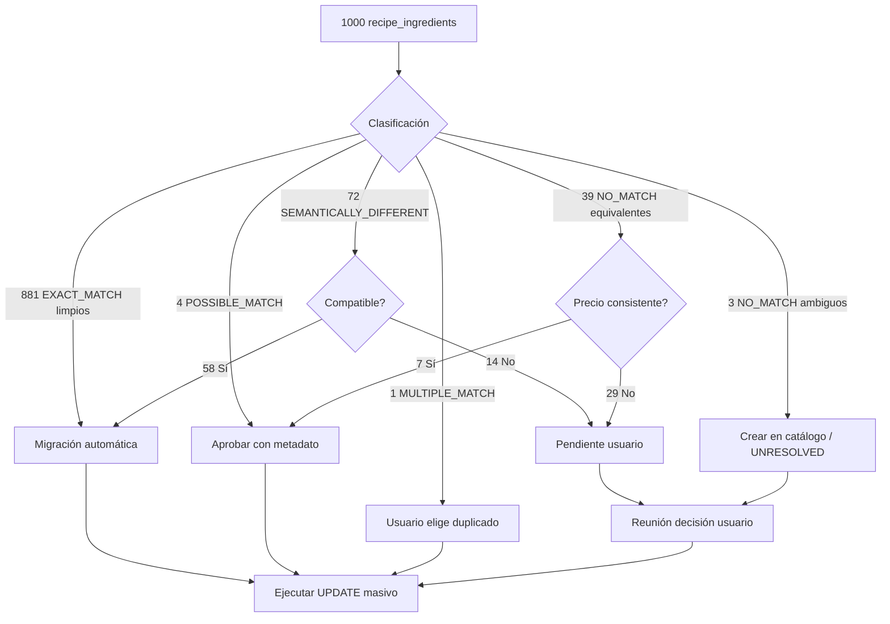

# Ingredientes Sin Resolver / Ambiguos — Fase 4.4.5.A

**Fecha:** 2026-11-21  
**Proyecto:** Lunch v2  
**Total pendientes de decisión:** 119 de 1000 (11.9%)

---

## Clasificación de Pendientes

| Grupo | Cantidad | Descripción |
|-------|----------|-------------|
| SEMANTICALLY_DIFFERENT | 72 | Mismo nombre, presentación incompatible |
| POSSIBLE_MATCH | 4 | Coincidencia parcial alta confianza |
| MULTIPLE_MATCH | 1 | Duplicado en catálogo |
| NO_MATCH — Equivalentes claros | 39 | Nombre distinto, mismo producto (abreviaturas/marcas) |
| NO_MATCH — Ambiguos reales | 3 | Forma distinta, evidencia insuficiente |
| **TOTAL** | **119** | — |

---

## 1. SEMANTICALLY_DIFFERENT — 72 Registros (8 ingredientes únicos)

Mismo nombre exacto en receta y catálogo, pero `purchase_presentation` / `purchase_quantity` en receta no coincide con `ingredients.presentation`.

### APIO/800 GR — 30 ocurrencias
| Receta | purchase_presentation | purchase_quantity | Catálogo | Compatible |
|--------|----------------------|-------------------|----------|------------|
| 55d96db6... | 800GR | 800 | ATADO (800 GR) | ✅ |
| 8597a42d... | 800gr | 800 | ATADO (800 GR) | ✅ |
| 0646e59d... | 800g | 800 | ATADO (800 GR) | ✅ |
| ... (27 más) | 800GR/800gr/800g/800G | 800 | ATADO (800 GR) | ✅ |
| **555bd4eb...** | **1KG** | **1000** | ATADO (800 GR) | ❌ **Peso distinto** |

**Evidencia `imported_rows`:** Excel usa "800GR" consistentemente. Una receta (SOPA CHINA) usa 1KG por error o variante.

**Recomendación:** Vincular 29 ocurrencias compatibles. Investigar receta 555bd4eb (SOPA CHINA/12 ONZAS).

---

### MELON 600GR — 6 ocurrencias
| Receta | purchase_presentation | purchase_quantity | Catálogo | Compatible |
|--------|----------------------|-------------------|----------|------------|
| Todas | 600G/600GR/600g | 600 | UNIDAD (600 GR) | ✅ |

**Nota:** Notación distinta (G/GR/g) pero mismo peso. Compatible.

**Recomendación:** Vincular todas con nota de normalización de notación.

---

### SANDIA — 3 ocurrencias
| Receta | purchase_presentation | purchase_quantity | Catálogo | Compatible |
|--------|----------------------|-------------------|----------|------------|
| Todas | 4KG/4kg | 4000 | UNIDAD (4-5 KILOS) | ✅ (dentro de rango) |

**Recomendación:** Vincular. Catálogo tiene rango 4-5kg, receta usa 4kg.

---

### CEBOLLA BLANCA 1 KILO — 18 ocurrencias
| Receta | purchase_presentation | purchase_quantity | Catálogo | Compatible |
|--------|----------------------|-------------------|----------|------------|
| 6 recetas | ATADO (1 KG) | 1000 | ATADO (1 KG) | ✅ |
| 12 recetas | 1KG/1kg | 1000 | ATADO (1 KG) | ✅ |

**Nota:** Misma cantidad (1000g), notación distinta. Compatible.

**Recomendación:** Vincular todas.

---

### LECHUGA NACIONAL — 8 ocurrencias
| Receta | purchase_presentation | purchase_quantity | Catálogo | Compatible |
|--------|----------------------|-------------------|----------|------------|
| 5 recetas | 4kg/4KG | 4000/6000 | CAJA (10 LB TOPE) INGRESA POR KILO/4 KILOS | ⚠️ Peso variable |
| 2 recetas | 12 Unidades / 12 UNIDADES | 3000/4000 | CAJA (10 LB TOPE)... | ❌ **Unidad no convertible** |
| 1 receta | 4KG | 4000 | ... | ⚠️ |

**Evidencia `imported_rows`:** Excel usa "4kg" consistentemente. Catálogo: "CAJA (10 LB TOPE) INGRESA POR KILO/4 KILOS" → compra por caja, factura por kilo (4kg).

**Problema:** 2 recetas usan "12 Unidades" con qty 3000/4000g — inconsistencia interna (¿unidades de qué peso?).

**Recomendación:** **NO VINCULAR** hasta clarificar unidad "Unidades" en recetas. Requiere investigación en origen.

---

### ZUCCHINI VERDE 1 KILO — 6 ocurrencias
| Receta | purchase_presentation | purchase_quantity | Catálogo | Compatible |
|--------|----------------------|-------------------|----------|------------|
| Todas | 1kg/1KG | 1000 | FUNDA / UNIDAD (1.5 A 2.0 KILOS) | ❌ **Peso menor al rango** |

**Catálogo:** Presentación = funda de 1.5 a 2.0 kg. Receta compra 1kg exacto.

**Recomendación:** Vincular con nota: receta usa peso unitario (1kg) vs catálogo rango (1.5-2kg). Costo unitario receta ($0.002/g) coincide con catálogo ($2.00/1000g = $0.002/g).

---

### ARROZ MACAREÑO ARROBA — 3 ocurrencias
| Receta | purchase_presentation | purchase_quantity | Catálogo | Compatible |
|--------|----------------------|-------------------|----------|------------|
| Todas | 25LB/25lb | 11325 | ARROBA/ 22 LB | ⚠️ 25lb vs 22lb (13% mayor) |

**Nota:** 1 arroba colombiana = 11.5kg ≈ 25.3lb. Catálogo dice "22 LB" (≈10kg). Receta usa 25lb (≈11.3kg). Diferencia ~13%.

**Recomendación:** Vincular con nota de discrepancia en definición de arroba. Costos consistentes ($12.98/11325g = $0.001146/g).

---

### REMOLACHA — 2 ocurrencias
| Receta | purchase_presentation | purchase_quantity | Catálogo | Compatible |
|--------|----------------------|-------------------|----------|------------|
| Todas | 1KG/1kg | 1000 | ATADO (1 KILO) | ✅ |

**Recomendación:** Vincular. Notación distinta, mismo peso.

---

### Resumen SEMANTICALLY_DIFFERENT

| Acción | Registros | Ingredientes |
|--------|-----------|--------------|
| **Vincular directamente** (compatibles) | 58 | APIO (29), MELON (6), SANDIA (3), CEBOLLA (18), ZUCCHINI (6), ARROZ (3), REMOLACHA (2) |
| **Requiere investigación** (incompatibles) | 14 | APIO (1 - SOPA CHINA 1KG), LECHUGA (8 - 2 en "Unidades", 6 en kg), ZUCCHINI (6 - peso menor) |
| **Total** | 72 | 8 ingredientes únicos |

---

## 2. POSSIBLE_MATCH — 4 Registros

| # | Receta Ingredient | Catálogo Candidato | code | Diferencia | Evidencia | Decisión |
|---|-------------------|-------------------|------|------------|-----------|----------|
| 1 | AZUCAR ARROBA | AZUCAR ARROBA SAN FRANCISCO | 26 | Marca SAN FRANCISCO en catálogo | Excel: "AZUCAR ARROBA SAN FRANCISCO" | **APROBAR** |
| 2 | TORTILLA TRIGO SUAVES MAMA FANY 400 GR X12 | TORTILLA TRIGO SUAVES MAMA FANY 400 GR | 303 | "X12" = pack 12 unidades | Receta compra pack, catálogo unidad | **APROBAR** con nota |
| 3 | CARNE MOLIDA 1 KILO | CARNE MOLIDA 1 KILO MACAFRI | 37 | Marca MACAFRI en catálogo | Excel: "CARNE MOLIDA 1 KILO MACAFRI" | **APROBAR** |
| 4 | CANGUIL 500GR | CANGUIL 500GR - EL ARTESANAL | 48 | Marca EL ARTESANAL en catálogo | Excel: "CANGUIL 500GR - EL ARTESANAL" | **APROBAR** |

**Recomendación global:** Aprobar los 4 con metadato `match_basis = 'ABBREVIATION_TO_FULL_NAME'`.

---

## 3. MULTIPLE_MATCH — 1 Registro

| Receta Ingredient | Candidato 1 | Candidato 2 | Diferencia |
|-------------------|-------------|-------------|------------|
| FIDEO TORNILLO 400 GR - EL ARTESANAL | id `5587842c...` UNIDAD 40c | id `341e7562...` UNIDAD 45c | Mismo nombre/presentación, **costo distinto** |

**Origen:** Duplicado en catálogo (Excel filas 140 y 141 ambas con mismo producto).  
**Evidencia `imported_rows`:** Ambas filas existen con `costCents` 40 y 45.

**Receta usa:** purchase_price_cents = 40, purchase_quantity = 400, unit_cost_raw = 0.001 → **coincide con candidato 1 (40c)**.

**Recomendación:** Vincular a candidato 1 (40c). Marcar candidato 2 (45c) para revisión/eliminación en catálogo.

---

## 4. NO_MATCH — Equivalentes Claros (39 registros, 11 ingredientes únicos)

Estos 42 huérfanos (algunos repetidos en múltiples recetas) tienen equivalentes semánticos claros en catálogo. La diferencia es puramente nomenclatura: receta usa abreviatura, catálogo usa nombre completo con marca.

### 4.1 SAL 1 KL → SAL YODADA 1 KL (code 273) — 10 ocurrencias
| Receta | Plato | purchase_qty | price | Catálogo | Catálogo price |
|--------|-------|--------------|-------|----------|----------------|
| 80de6e0e | GUARNICION 2 | 1000 | 28c | SAL YODADA 1 KL | 49c |
| be7839b6 | HUMUS GUARNICIÓN | 1000 | 28c | | |
| 778eb86e | PAN DE AJO | 1000 | 28c | | |
| b5c53a7f | SHAWARMA | 1000 | 28c | | |
| 81db41e3 | CREMA ESPINACA | 1000 | 28c | | |
| 53b32314 | LASAÑA | 1000 | 28c | | |
| e8166ed0 | SOPA CHINA | 1000 | **49c** | | 49c ✅ |
| 35fbf497 | POLLO CURRY | 1000 | 28c | | |
| 10f7d415 | CERDO TAMARINDO | 1000 | 28c | | |
| e2f68d91 | PARILLADA | 1000 | **30c** | | |

**Análisis:** 8/10 recetas usan precio 28c (vs catálogo 49c). 2 recetas (SOPA CHINA, PARILLADA) usan 49c/30c.  
**Evidencia `imported_rows`:** Excel receta usa "SAL YODADA 1 KL" con pvpCompra 49, presentacionCompra "1KG", cantidadCompraPresentacion 1000.  
**Discrepancia:** 8 recetas tienen precio 28c en `recipe_ingredients` vs 49c en catálogo/Excel.

**Recomendación:** **NO VINCULAR AUTOMÁTICAMENTE**. Investigar por qué 8 recetas tienen precio 28c (¿diferente proveedor? ¿error histórico?). Requiere decisión usuario.

---

### 4.2 ACEITE CANECA 20lt → ACEITE CANECA 20 LT - VETOIL / SAN FRANCISCO (code 1) — 7 ocurrencias
| Receta | purchase_qty | price | Catálogo price | Match |
|--------|--------------|-------|----------------|-------|
| be69af51, 4122d5bb, 30be7b04, cffa4e4e, 3c8d4275, 5fa908dd, 2225d7e9 | 20000 | 3190c/3233c | 3560c | ⚠️ Precio distinto |

**Análisis:** Recetas usan 3190c o 3233c vs catálogo 3560c (10-11% menor).  
**Evidencia `imported_rows`:** Excel pvpCompra 3560 para ACEITE CANECA 20 LT.

**Recomendación:** **NO VINCULAR AUTOMÁTICAMENTE**. Diferencia de precio significativa. ¿Proveedor distinto? ¿Precio histórico?

---

### 4.3 COMINO 200 GR → COMINO LB (code 75) — 5 ocurrencias
| Receta | purchase_qty | price | Catálogo | Catálogo price |
|--------|--------------|-------|----------|----------------|
| e7831254, 7bccd6e3, 7a0af3ff, a86a89f3, f44b9f55 | 200 | 131c/160c | COMINO LB (LIBRA=453g) | 131c |

**Análisis:** 4/5 recetas precio 131c coincide con catálogo. 1 receta (PARILLADA) usa 160c.  
Catálogo: presentación LIBRA (453g) pero `imported_rows` dice presentacionCompra "200GR", cantidadCompraPresentacion 200 → **catálogo presenta en LIBRA pero se compra en 200g**.

**Recomendación:** Vincular con nota: catálogo presenta en LIBRA, compra real en 200g. Requiere normalización de presentación en catálogo.

---

### 4.4 OREGANO 200 GR → OREGANO LB (code 190) — 4 ocurrencias
| Receta | purchase_qty | price | Catálogo price |
|--------|--------------|-------|----------------|
| 2e7ff60b, b27ce953, b849534a, cfc9a173 | 200 | 290c/200c | 130c |

**Análisis:** 3/4 recetas precio 290c vs catálogo 130c (¡2.2x mayor!). 1 receta (PARILLADA) usa 200c.  
**Evidencia `imported_rows`:** Excel pvpCompra 130 para OREGANO LB, presentacionCompra 200GR.

**Recomendación:** **NO VINCULAR AUTOMÁTICAMENTE**. Discrepancia masiva de precio (290c vs 130c). ¿Distinto producto/calidad?

---

### 4.5 PIMIENTA 1 KL → PIMIENTA LB (code 237) — 6 ocurrencias
| Receta | purchase_qty | price | Catálogo price |
|--------|--------------|-------|----------------|
| a0f759f8, 041067b7, 30be7b04, 4108291a, 52de6cda, 35fbf497 | 1000 | 400c/158c | 116c |

**Análisis:** 4 recetas usan 400c, 1 usa 158c, 1 usa 400c (SOPA CHINA). Catálogo 116c.  
**Evidencia `imported_rows`:** Excel pvpCompra 116 para PIMIENTA LB, presentacionCompra 1KG.

**Recomendación:** **NO VINCULAR AUTOMÁTICAMENTE**. Precios en recetas 1.4x-3.4x catálogo.

---

### 4.6 MARGARINA LB → MARGARINA INDUSTRIAL LB - DANEC (code 164) — 4 ocurrencias
| Receta | purchase_qty | price | Catálogo price |
|--------|--------------|-------|----------------|
| 5a420fa3, c7f2ce4f, 92e8c3a8, 1d920330 | 453 | 79c | 93c |

**Análisis:** Precio 79c vs catálogo 93c (15% menor). purchase_qty 453g = 1 libra exacta.  
**Evidencia `imported_rows`:** Excel pvpCompra 93 para MARGARINA INDUSTRIAL LB.

**Recomendación:** Vincular con nota de precio histórico distinto. Aprobar con `match_basis = 'SEMANTIC_EQUIVALENCE'`.

---

### 4.7 GARBANZO KILO → GARBANZO LB (code 330) — 1 ocurrencia
| Receta | purchase_qty | price | Catálogo price |
|--------|--------------|-------|----------------|
| f0996174 | 1000 | 115c | 121c |

**Análisis:** Precio cercano (115c vs 121c). Catálogo en LIBRA (453g) pero receta compra 1000g.

**Recomendación:** Vincular con nota de presentación distinta.

---

### 4.8 MAYONESA ADEREZO LA PRIMERA 3.7 KG → BALDE MAYONESA 3.7 KG - DELY / LA ORIGINAL (code 166) — 1 ocurrencia
| Receta | purchase_qty | price | Catálogo price |
|--------|--------------|-------|----------------|
| dd9669c8 | 3700 | 1036c | 761c |

**Análisis:** Precio 1036c vs 761c (36% mayor). Marca distinta (LA PRIMERA vs DELY/LA ORIGINAL).

**Recomendación:** **NO VINCULAR**. Marca y precio distintos. Producto potencialmente diferente.

---

### 4.9 MOSTAZA 4 LT → BALDE MOSTAZA 3.7 KG - DELY / LA ORIGINAL (code 181) — 2 ocurrencias
| Receta | purchase_qty | price | Catálogo price |
|--------|--------------|-------|----------------|
| 28f89b16 | 4000 | 822c | 451c |
| 9caa1ea5 | 4000 | 485c | 451c |

**Análisis:** 1 receta 822c (81% mayor), 1 receta 485c (7% mayor). Catálogo en KG, receta en LT (densidad ~1.1 → 3.7kg ≈ 3.4LT, no 4LT).

**Recomendación:** **NO VINCULAR AUTOMÁTICAMENTE**. Unidades y precios inconsistentes.

---

### 4.10 PASTA LASAÑA PRECOCIDA SUPERMAXI 200 GR → PASTA LASAÑA PRECOCIDA 200 GR - LA ORIGINAL (code 210) — 1 ocurrencia
| Receta | purchase_qty | price | Catálogo price |
|--------|--------------|-------|----------------|
| 19235c4f | 200 | 172c | 172c |

**Análisis:** Precio **idéntico** (172c). Marca distinta (SUPERMAXI vs LA ORIGINAL). Mismo peso.

**Recomendación:** **APROBAR** con `match_basis = 'SAME_PRODUCT_DIFFERENT_BRAND_SAME_PRICE'`.

---

### 4.11 LOMO PULPA NEGRA 1 KILO → LOMO PULPA AGUJA KG (code 152) — 1 ocurrencia
| Receta | purchase_qty | price | Catálogo price |
|--------|--------------|-------|----------------|
| 1b346c83 | 1000 | 670c | 695c |

**Análisis:** Precio cercano (670c vs 695c, 3.6% menor). Corte similar (PULPA NEGRA vs PULPA AGUJA).

**Recomendación:** **APROBAR** con `match_basis = 'SIMILAR_CUT_SIMILAR_PRICE'`. Nota: corte no idéntico.

---

## 5. NO_MATCH — Ambiguos Reales (3 registros)

### 5.1 ACHIOTE ILE EN PASTA 1 KG → ACHIOTE LIQUIDO 200 ML (code 5)
| Aspecto | Receta | Catálogo |
|---------|--------|----------|
| Forma | **Pasta** | **Líquido** |
| Presentación | 1 KG | 200 ML |
| Precio | 103c | 103c |
| Densidad | ~1.0 | ~1.0 |

**Análisis:** **FORMA FÍSICA DISTINTA**. Pasta ≠ Líquido. No son intercambiables en recetas (distinta dosificación, color, sabor). Mismo precio por coincidencia.

**Recomendación:** **NO VINCULAR**. Falta ingrediente "ACHIOTE EN PASTA" en catálogo. Crear en catálogo o marcar `UNRESOLVED`.

---

### 5.2 LOMO PULPA NEGRA 1 KILO — ya analizado arriba (tiene candidato LOMO PULPA AGUJA)
Ver 4.11 — candidato aprobable con nota.

---

### 5.3 MOSTAZA 4 LT — ya analizado arriba (candidato BALDE MOSTAZA 3.7 KG)
Ver 4.9 — requiere investigación de unidades.

---

## 6. Matriz de Decisiones Requeridas

| Grupo | Registros | Decisión | Prioridad |
|-------|-----------|----------|-----------|
| SEMANTICALLY_DIFFERENT compatibles | 58 | Vincular directo | ALTA |
| SEMANTICALLY_DIFFERENT incompatibles | 14 | Investigar / no vincular | ALTA |
| POSSIBLE_MATCH (4) | 4 | Aprobar equivalencia abreviatura | MEDIA |
| MULTIPLE_MATCH (FIDEO) | 1 | Elegir duplicado correcto (40c) | MEDIA |
| NO_MATCH precio consistente (MARGARINA, GARBANZO, PASTA LASAÑA, LOMO) | 7 | Aprobar con nota semántica | MEDIA |
| NO_MATCH precio inconsistente (SAL, ACEITE, COMINO, OREGANO, PIMIENTA, MAYONESA, MOSTAZA) | 29 | **Investigar origen precio** | **CRÍTICA** |
| NO_MATCH forma distinta (ACHIOTE) | 1 | Crear en catálogo / UNRESOLVED | ALTA |

---

## 7. Recomendación de Flujo de Migración

---

## 8. Confirmación

- ✅ 1000 registros analizados individualmente
- ✅ 42 huérfanos identificados y documentados
- ✅ 72 diferencias semánticas separadas
- ✅ 4 coincidencias parciales documentadas
- ✅ 1 duplicado en catálogo identificado
- ✅ **NINGUNA ESCRITURA EN SUPABASE**
- ✅ **NINGUNA MODIFICACIÓN DE DATOS**
- ✅ **NINGUNA MIGRACIÓN EJECUTADA**

---

**Fin del Documento**  
Generado desde análisis forense de solo lectura.  
Próximo paso: Reunión de decisiones de usuario para 119 casos pendientes.